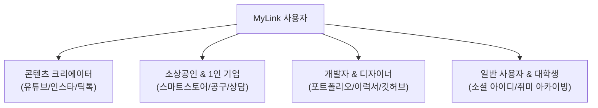
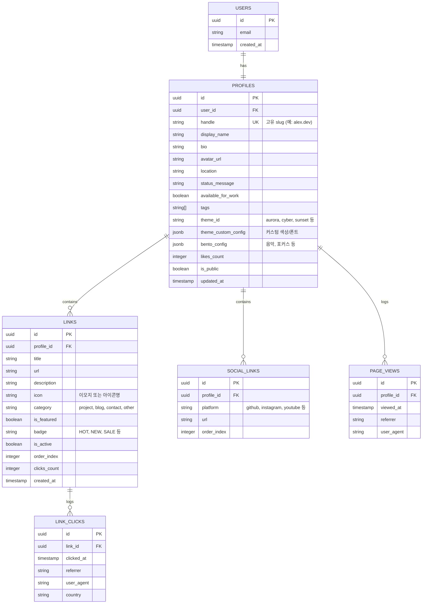
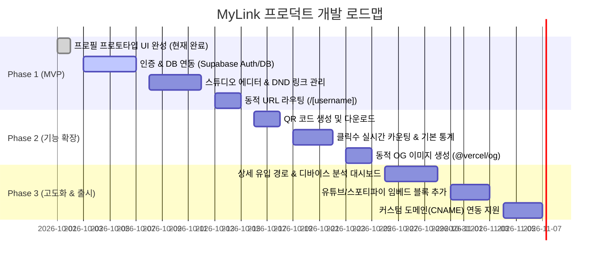

# [PRD] MyLink - 올인원 프로필 링크(Link-in-Bio) 서비스 기능정의서

---

## 1. 문서 개요 (Document Overview)

| 항목 | 내용 |
| :--- | :--- |
| **문서명** | MyLink 서비스 제품 요구사항 정의서 (PRD / Functional Specification) |
| **버전** | v1.1.0 |
| **작성일자** | 2026-10-02 |
| **디자인 시스템** | **shadcn/ui** (Base Sera / Preset: `b1abLTZk8`) 표준 적용 |
| **작성 목적** | 모바일 최적화 링크트리(Link-in-bio) 서비스의 핵심 기능, 사용자 경험, 시스템 아키텍처, 데이터 모델 및 개발 로드맵 명세 |
| **적용 프로젝트** | `projects/mylink` (Next.js 16, React 19, TypeScript, Tailwind CSS v4) |
| **문서 상태** | 확정 (Approved) |

---

## 2. 프로젝트 배경 및 목적 (Background & Objectives)

### 2.1 배경 및 문제 정의 (Problem Statement)
* **SNS 링크 제약**: 인스타그램, 틱톡, 트위터(X), 유튜브 등 주요 플랫폼은 프로필 영역에 단 1개(또는 제한된 수)의 외부 링크만 허용합니다.
* **분산된 콘텐츠 채널**: 크리에이터, 1인 사업자, 개발자 등은 블로그, 깃허브, 스마트스토어, 포트폴리오, 오픈카카오톡 등 다양한 채널을 운영하지만 이를 일목요연하게 전달할 수 있는 단일 창구가 부재합니다.
* **기존 서비스의 한계**: 기존 링크트리형 서비스들은 커스텀 테마 제약, 무료 버전의 광고 노출, 데이터 추적 한계, 한국형 SNS/플랫폼 지원 미흡 등의 아쉬움이 있습니다.

### 2.2 제품 비전 및 핵심 가치 (Product Vision & Core Values)
> **"나를 표현하는 단 하나의 가장 아름답고 스마트한 링크"**

1. **원클릭 허브**: 흩어진 모든 온라인 활동을 단 하나의 단축 URL(`mylink.bio/@username`)로 통합.
2. **감각적인 비주얼**: 누구나 1분 만에 감성적인 테마(오로라, 네온, 글래스모피즘 등)와 벤토 그리드(Bento Grid) 스타일로 프로필 완성.
3. **실시간 미리보기 & 즉각 반영**: 관리자 화면에서 편집하는 즉시 모바일 목업 화면으로 시각적 확인.
4. **인사이트 제공**: 링크별 클릭 수, 유입 경로, 방문자 추이를 직관적인 통계로 시각화.

### 2.3 타겟 고객 페르소나 (Target Personas)



* **Persona A (인플루언서 / 크리에이터)**:
  * 최신 유튜브 영상, 인스타 공구 링크, 틱톡 챌린지를 수시로 교체하고 클릭 순위를 파악하고 싶음.
* **Persona B (개발자 / 디자이너)**:
  * 깃허브, 벨로그/티스토리, 포트폴리오 사이트, PDF 이력서를 트렌디한 다크모드/개발자 감성 테마로 연동하고 싶음.
* **Persona C (스마트스토어 / 소상공인)**:
  * 매장 위치 지도, 카카오 채널 문의, 네이버 예약, 인스타 마켓 링크를 한눈에 보여주고 QR 코드로 오프라인 매장에 비치하고 싶음.

---

## 3. 정보 구조 및 사용자 흐름 (IA & User Journey)

### 3.1 정보 구조도 (Information Architecture)

```
MyLink
├── [공개 랜딩 페이지] (/) : 서비스 소개, 주요 기능, 템플릿 쇼케이스, 로그인/가입 CTA
├── [인증]
│   ├── 로그인 (/login) : 소셜 로그인(구글, 카카오), 이메일 매직링크/비밀번호
│   └── 회원가입 (/register) : 고유 핸들(@username) 선점 및 프로필 온보딩
├── [스튜디오 / 관리자 대시보드] (/admin or /dashboard or /studio)
│   ├── [1. 프로필 관리] : 이름, 핸들, 바이오, 프로필/배너 이미지, 배지 태그
│   ├── [2. 링크 & 블록] : 링크 추가/수정/삭제, 순서 변경(DND), 노출 토글, 카테고리
│   ├── [3. 테마 & 스타일] : 프리셋 테마 선택, 배경/버튼/폰트 커스텀
│   ├── [4. 통계 & 분석] : 총 방문자, 링크별 클릭 수, CTR, 유입 경로
│   └── [5. 계정 설정] : URL 변경, 공개 여부, 계정 탈퇴
└── [공개 프로필 페이지] (/[username] or /profile)
    ├── 상단 프로필 영역 (아바타, 이름, 핸들, 바이오, SNS 아이콘 바)
    ├── 벤토 그리드 블록 (음악, 현재 관심사, 상태 배지)
    ├── 링크 목록 (카테고리 탭 필터링, 검색, 카드형 링크, 외부 링크 아웃링크)
    ├── 공유 & QR 모달 (링크 복사, 시스템 공유, QR 코드 다운로드)
    └── 좋아요/응원 인터랙션 (파티클 애니메이션)
```

### 3.2 핵심 사용자 흐름 (User Journey)

1. **신규 가입자 온보딩 흐름**:
   `랜딩 페이지 접속` → `구글/카카오 원클릭 로그인` → `원하는 유저네임(@handle) 입력 및 중복 검사` → `기본 프로필 & 첫 링크 2개 입력` → `테마 선택` → `나만의 공개 링크 즉시 생성 및 복사`
2. **프로필 수정 흐름**:
   `스튜디오 접속` → `좌측 에디터에서 링크 추가 및 드래그 앤 드롭 정렬` → `우측 모바일 폰 목업에서 실시간 반영 확인` → `저장 완료`
3. **방문자 경험 흐름**:
   `인스타그램 프로필 링크(mylink.bio/@alex) 클릭` → `1초 이내 로딩` → `원하는 링크 터치` → `클릭 수 카운팅 및 외부 사이트 새 창 오픈`

---

## 4. 상세 기능 명세서 (Functional Requirements)

### 4.1 회원 관리 및 인증 (Authentication & Account)

| 기능 ID | 기능명 | 상세 내용 | 우선순위 |
| :--- | :--- | :--- | :--- |
| **AUTH-01** | 소셜 로그인 | Google, Kakao OAuth 연동을 통한 비밀번호 없는 간편 가입/로그인 | P0 (필수) |
| **AUTH-02** | 이메일 인증 | 이메일/비밀번호 로그인 및 비밀번호 재설정 | P1 |
| **AUTH-03** | 고유 핸들(@username) 생성 | 영문 소문자, 숫자, 언더바(`_`), 마침표(`.`) 허용 (3~20자), 실시간 중복 체크 | P0 (필수) |
| **AUTH-04** | 프로필 URL 라우팅 | `/[username]` 경로를 통한 개인화된 프로필 랜딩 페이지 제공 | P0 (필수) |
| **AUTH-05** | 세션 및 보안 | JWT 기반 인증 쿠키 세션 유지, RLS(Row Level Security)를 통한 본인 데이터만 수정 가능 | P0 (필수) |

### 4.2 프로필 & 바이오 설정 (Profile & Bio)

| 기능 ID | 기능명 | 상세 내용 | 우선순위 |
| :--- | :--- | :--- | :--- |
| **PROF-01** | 프로필 이미지 관리 | 이미지 파일 업로드(JPEG, PNG, WebP / 최대 5MB), 원형 크롭 프리뷰 | P0 (필수) |
| **PROF-02** | 기본 정보 입력 | 표시 이름(Display Name, 최대 30자), 한 줄 소개(Bio, 최대 150자) | P0 (필수) |
| **PROF-03** | 위치 및 상태 메시지 | 거주지/활동 지역(Location), 실시간 한 줄 상태("🚀 프로젝트 출시 준비 중") | P1 |
| **PROF-04** | 업무 가능 여부 배지 | 'Available for work' 토글 스위치 (ON/OFF 시 프로필 상단 뱃지 표시) | P1 |
| **PROF-05** | 전문 분야 태그 | 키워드 태그 추가/삭제 (예: Next.js, React, UI/UX, AI 등 최대 5개) | P1 |
| **PROF-06** | SNS 아이콘 바 | GitHub, LinkedIn, X(Twitter), Instagram, YouTube, Threads, Email 등 URL 입력 시 규격화된 아이콘 바 자동 렌더링 | P0 (필수) |

### 4.3 링크 & 블록 관리 (Links & Blocks)

| 기능 ID | 기능명 | 상세 내용 | 우선순위 |
| :--- | :--- | :--- | :--- |
| **LINK-01** | 링크 추가/수정/삭제 | 제목, 대상 URL, 설명(선택), 대표 이모지/아이콘, 카테고리 지정 | P0 (필수) |
| **LINK-02** | 드래그 앤 드롭 정렬 | `@dnd-kit`을 활용하여 마우스/터치 드래그로 링크 노출 순서 재배치 | P0 (필수) |
| **LINK-03** | 노출/숨김 활성 토글 | 삭제하지 않고도 일시적으로 링크를 감출 수 있는 활성화 스위치 | P0 (필수) |
| **LINK-04** | 강조 링크 (Featured / Hot) | 특정 링크 카드에 하이라이트 애니메이션(펄스/글로우) 및 'HOT', 'NEW' 배지 부착 | P1 |
| **LINK-05** | 카테고리 탭 분류 | 전체, 프로젝트, 블로그, 연락처 등 탭으로 링크 필터링 기능 | P1 |
| **LINK-06** | 벤토 그리드(Bento) 블록 | 오늘의 추천 음악(노래/가수), 지금 집중하고 있는 일 등 위젯 카드 블록 제공 | P1 |
| **LINK-07** | 미디어 임베드 블록 | 유튜브 영상 플레이어 임베드, 스포티파이/사운드클라우드 플레이어 | P2 |

### 4.4 테마 및 비주얼 커스터마이징 (Themes & Styling)

| 기능 ID | 기능명 | 상세 내용 | 우선순위 |
| :--- | :--- | :--- | :--- |
| **THM-01** | 프리셋 테마 6종 | 1. Aurora Indigo (신비로운 우주/오로라)<br/>2. Cyber Neon (사이버펑크 네온)<br/>3. Sunset Coral (따스한 로즈 골드 노을)<br/>4. Emerald Forest (싱그러운 숲)<br/>5. Midnight Mono (하이엔드 블랙/미니멀)<br/>6. Pure Pearl (세련된 라이트 글래스) | P0 (필수) |
| **THM-02** | 실시간 미리보기 (WYSIWYG) | 관리자 페이지 우측에 모바일 폰 뷰어를 배치하여 테마 변경 즉시 반영 | P0 (필수) |
| **THM-03** | 커스텀 컬러 및 배경 | 단색 배경, 그래디언트 배경, 블러 효과(Backdrop Blur) 조절 | P1 |
| **THM-04** | 버튼 스타일 커스텀 | 라운드(Rounded: 둥글게, 각지게, 필 형태), 테두리 두께, 그림자 효과 | P1 |

### 4.5 공개 프로필 뷰어 & 인터랙션 (Public Profile Viewer)

| 기능 ID | 기능명 | 상세 내용 | 우선순위 |
| :--- | :--- | :--- | :--- |
| **VIEW-01** | 모바일 최적화 레이아웃 | 375px~430px 모바일 화면에 최적화된 반응형 뷰어, 데스크톱에서는 중앙 카드 뷰 | P0 (필수) |
| **VIEW-02** | 링크 검색 및 필터 | 수많은 링크 중 원하는 링크를 키워드로 즉시 검색하는 인라인 검색바 | P1 |
| **VIEW-03** | 좋아요 & 응원하기 | 방문자가 하트 버튼을 누르면 플로팅 하트 파티클 효과와 함께 좋아요 수 증가 | P1 |
| **VIEW-04** | 링크 리다이렉트 & 트래킹 | 링크 클릭 시 새 탭으로 열기 전 클릭 로그 비동기 기록 (`/api/track`) | P0 (필수) |

### 4.6 공유 및 유입 도구 (Share & Viral Growth)

| 기능 ID | 기능명 | 상세 내용 | 우선순위 |
| :--- | :--- | :--- | :--- |
| **SHR-01** | 링크 클립보드 복사 | 원클릭으로 `mylink.bio/@username` 복사 및 복사 완료 토스트 알림 | P0 (필수) |
| **SHR-02** | 웹 공유 API 연동 | 모바일 브라우저 기본 공유 시트(카카오톡, 인스타, 메시지) 호출 | P0 (필수) |
| **SHR-03** | QR 코드 자동 생성 | 해당 프로필 URL의 고해상도 SVG/PNG QR 코드 즉시 생성 및 다운로드 | P1 |
| **SHR-04** | 동적 OG (OpenGraph) 메타태그 | SNS 공유 시 프로필 사진, 닉네임, 소개글이 미리보기 카드로 노출 | P0 (필수) |

### 4.7 통계 및 분석 (Analytics)

| 기능 ID | 기능명 | 상세 내용 | 우선순위 |
| :--- | :--- | :--- | :--- |
| **ANL-01** | 총 조회수(PV) 및 방문자수(UV) | 일자별/주간별/월간별 프로필 페이지 방문 트래픽 통계 | P1 |
| **ANL-02** | 링크별 클릭 수 & CTR | 어떤 링크가 가장 많이 클릭되었는지 순위 및 클릭률(클릭/방문자) 시각화 | P0 (필수) |
| **ANL-03** | 유입 경로(Referrer) 분석 | 인스타그램, 틱톡, 트위터, 네이버, 직접 접속 비율 파이차트 제공 | P2 |
| **ANL-04** | 디바이스/OS 환경 통계 | 모바일(iOS/Android) vs 데스크톱 비율 분석 | P2 |

### 4.8 디자인 시스템 표준 및 shadcn/ui 가이드라인 (Design System Standards)

> **원칙**: 앞으로 진행되는 모든 UI/UX 디자인 및 컴포넌트 구현은 **`shadcn/ui`** 디자인 시스템 기반으로 일관되게 진행한다.

| 항목 | 표준 명세 및 규칙 |
| :--- | :--- |
| **기반 프리셋** | `b1abLTZk8` (Style: `base-sera`, Base Color: `neutral`, CSS Variables 기반 테마 토큰) |
| **컴포넌트 추가 표준** | 필요한 UI 컴포넌트는 `pnpm dlx shadcn@latest add <component>`를 통해 공식 컴포넌트를 설치하고 커스터마이징하여 사용 |
| **적용 대상 컴포넌트** | • **Button**: 액션 버튼, 링크 버튼 (default, outline, ghost, destructive)<br/>• **Dialog / Modal**: QR 코드 뷰어, 프로필 수정, 링크 상세 설정 모달<br/>• **Input / Textarea**: 링크 제목, URL, 소개글, 태그 입력 필드<br/>• **Tabs**: 스튜디오 편집 탭(링크, 프로필, 테마, 통계) 및 링크 카테고리 필터<br/>• **Switch**: 링크 노출 활성화, 협업 가능(Work Available) 토글<br/>• **Card / Badge**: 프로필 정보 카드, 링크 카드, 'HOT'/'NEW' 강조 배지<br/>• **Dropdown Menu**: 링크 추가 옵션, 프로필 관리 메뉴 |
| **디자인 토큰 일관성** | • `globals.css`에 선언된 디자인 토큰(`--background`, `--foreground`, `--primary`, `--border`, `--radius` 등)을 엄격히 준수<br/>• 하드코딩된 색상값 지양, Semantic CSS 변수 및 Tailwind 유틸리티 우선 사용<br/>• 반응형 및 다크/라이트 모드 자동 전환 완벽 지원 |
| **아이콘 표준** | `lucide-react`를 표준 아이콘 세트로 채택하여 디자인 일관성 유지 |
| **클래스 병합 유틸리티** | 조건부 스타일링 시 `src/lib/utils.ts`의 `cn()` 유틸리티 함수를 일관되게 사용 |

---

## 5. 데이터 모델 및 스키마 설계 (Data Model & Schema)

### 5.1 엔티티 관계 다이어그램 (ERD)



---

## 6. 시스템 아키텍처 및 기술 스택 (System Architecture)

```
[클라이언트 계층]
  Next.js 16 (React 19) App Router
  - 디자인 시스템: shadcn/ui (Base Sera / Preset: b1abLTZk8)
  - 스타일링: Tailwind CSS v4 + tw-animate-css + CSS Variables
  - 아이콘: Lucide Icons (`lucide-react`)
  - 드래그 앤 드롭: @dnd-kit (링크 순서 정렬)
  - QR 코드: qrcode (고해상도 QR 생성 및 다운로드)
       │
       ▼
[서버 / API 계층 (Next.js)]
  - Server Actions & Route Handlers (`/api/track`, `/api/profile`)
  - Dynamic OpenGraph Image (`@vercel/og` 동적 썸네일 생성)
  - ISR / Edge Caching (공개 프로필 페이지 1초 미만 초고속 로딩)
       │
       ▼
[백엔드 & 데이터베이스]
  - Supabase (PostgreSQL 16)
    - Row Level Security (RLS) 보안 정책 적용
    - Supabase Auth (OAuth Google/Kakao + Email Magic Link)
    - Supabase Storage (프로필 아바타 및 링크 이미지 CDN 서빙)
```

---

## 7. 비기능적 요구사항 (Non-Functional Requirements)

1. **초고속 성능 (Performance)**
   * 공개 프로필 페이지는 모바일 접속 비율이 85% 이상이므로, **LCP(Largest Contentful Paint) < 1.2초** 이내를 목표로 함.
   * 이미지 최적화: `next/image`를 사용해 WebP/AVIF로 자동 변환 및 Lazy Loading 적용.
2. **모바일 퍼스트 UX (Mobile-First Experience)**
   * 엄지손가락 영역(Thumb Zone)을 고려한 하단 액션 버튼 및 모달 배치.
   * 터치 반응성 극대화: 탭 시 부드러운 햅틱 느낌의 스케일 인터랙션 (`active:scale-95`).
3. **SEO 및 소셜 공유 최적화 (SEO & OpenGraph)**
   * 메타 태그 완비: `og:title`, `og:description`, `og:image`, `twitter:card`.
   * 검색 엔진 노출을 위한 시맨틱 마크업 (`<main>`, `<article>`, `<header>`).
4. **보안성 (Security)**
   * 악성 URL 필터링: 자바스크립트 스키마(`javascript:`) 차단, `https://` 프로토콜 강제.
   * 외부 링크 오픈 시 보안 속성 적용: `rel="noopener noreferrer"`.
   * 클라이언트 입력값 검증 (Zod 스키마 검증).

---

## 8. 단계별 개발 로드맵 (Phased Roadmap)



* **Phase 1 (MVP - 약 1~2주)**:
  * 목표: 실제 동작하는 회원가입 및 링크 생성/공유 가능 상태
  * 산출물: Supabase 연동, 본인 링크 추가/삭제/정렬, 프리셋 테마 6종, `/[username]` 공개 프로필.
* **Phase 2 (확장 - 약 1주)**:
  * 목표: 공유 유도 및 실시간 통계 기초 수립
  * 산출물: QR 코드 생성, 실시간 클릭 로그 수집, 카테고리 필터링, 동적 OG 카드.
* **Phase 3 (상용화 - 약 1~2주)**:
  * 목표: 크리에이터 친화형 분석 대시보드 및 미디어 블록
  * 산출물: 유입 채널 분석, 임베드 위젯(유튜브 영상 등), 다크/라이트 커스텀 도메인.

---

## 9. 성공 측정 지표 (Key Success Metrics)

1. **가입자 활성화율 (Activation Rate)**: 가입 후 24시간 내 프로필 링크를 3개 이상 등록하고 공개 URL을 1회 이상 공유한 사용자 비율 (목표: > 65%).
2. **공개 프로필 로딩 속도 (Page Speed)**: 모바일 환경에서 LCP 1.2초 미만 (목표: 95% 이상 트래픽 충족).
3. **링크 클릭률 (Average CTR)**: 프로필 방문 대비 링크 클릭 발생률 (목표: > 40%).
4. **리텐션 (Retention)**: 주 1회 이상 새로운 링크를 업데이트하거나 통계를 확인하는 유저 비율.
